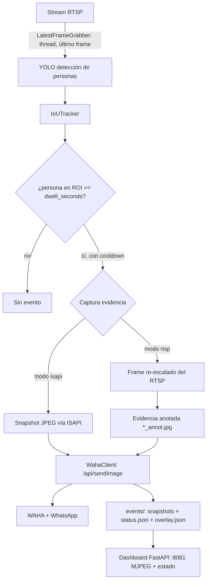

# ipcam-hunter

Sistema de alertas de vigilancia por ROI con detección de personas vía YOLO sobre stream RTSP: si una persona permanece más de N segundos dentro de la región de interés, captura un snapshot y lo envía a un grupo de WhatsApp vía WAHA. Incluye dashboard web con video en vivo y overlay del ROI.

[](https://python.org)
[](https://docs.ultralytics.com/)
[](https://www.docker.com/)

## Contenido

- [Características](#características)
- [Arquitectura](#arquitectura)
- [Stack](#stack)
- [Estructura del repositorio](#estructura-del-repositorio)
- [Instalación](#instalación)
- [Desarrollo y calidad](#desarrollo-y-calidad)
- [Uso](#uso)
- [Login WhatsApp](#login-whatsapp)
- [Obtener el chat_id del grupo](#obtener-el-chat_id-del-grupo)
- [Snapshot en máxima calidad (ISAPI)](#snapshot-en-máxima-calidad-isapi)
- [Logs y outputs](#logs-y-outputs)
- [Dashboard web](#dashboard-web)
- [Configuración](#configuración)
- [Licencia](#licencia)

## Características

- Detección de personas con YOLO (`yolov8n.pt`) sobre frames RTSP
- Seguimiento con tracker IoU y medición de dwell (tiempo dentro del ROI)
- Alerta si una persona permanece ≥ 2s dentro del ROI; al salir, se resetea
- Anti-spam con `cooldown_seconds`
- Envío de snapshot a grupo WhatsApp (chatId `...@g.us`) vía WAHA
- Evidencia anotada con overlay (bboxes + ROI) para el dashboard
- Snapshot ISAPI opcional (foto de máxima calidad vía cámara Hikvision)
- Dashboard web FastAPI con video MJPEG, overlay del ROI y estado en tiempo real

## Arquitectura



## Stack

| Componente | Tecnología |
|---|---|
| Detección | Ultralytics YOLO (yolov8n.pt) + PyTorch (CPU) |
| Visión | OpenCV + NumPy |
| Alerta | WAHA (WhatsApp HTTP API) |
| Dashboard | FastAPI + uvicorn + Jinja2 |
| Orquestación | Docker Compose (waha, roi-alert, dashboard) |
| Configuración | YAML (`app/config.yaml`) + variables de entorno |

## Estructura del repositorio

```
ipcam-hunter/
├── app/
│   ├── config.yaml             # Configuración del worker (roi, dwell, whatsapp)
│   ├── requirements.txt        # (compat Docker; fuente de verdad: pyproject.toml)
│   ├── roi_dwell_alert.py      # Entry point del worker (script: roi-hunter)
│   ├── roi_pick.py             # Dibuja ROI sobre frame RTSP (script: roi-pick)
│   ├── roi_alert/
│   │   ├── runner.py           # Orquestación: captura + detección + loop
│   │   ├── settings.py         # Config unificada (env + config.yaml)
│   │   ├── dwell.py            # Reglas de ROI: dwell, cooldown, stats
│   │   ├── events.py           # Worker de eventos + evidencia/persistencia
│   │   ├── rtsp.py             # LatestFrameGrabber (thread)
│   │   ├── tracker.py          # IoUTracker
│   │   ├── vision.py           # IoU, centroide, point_in_roi, overlay
│   │   ├── waha.py             # Cliente WAHA (sendImage)
│   │   ├── evidence.py         # Snapshot ISAPI (digest/basic auth)
│   │   ├── cfg.py, roi_json.py, types.py, utils.py
│   ├── tools/get_groups.py     # Obtener chat_id de grupos WhatsApp
│   └── web/                    # Dashboard FastAPI
│       ├── Dockerfile, requirements.txt
│       └── webapp/ (main, routers, services overlay/streaming/mjpeg)
├── tests/                      # pytest (roi_alert + webapp), con mocks
├── docs/                       # migration.md, quality-report.md
├── .github/workflows/ci.yml    # lint + typecheck + tests
├── pyproject.toml              # deps, extras [dev]/[detect], ruff/mypy/pytest
├── docker/
│   └── app/entrypoint.sh
├── scripts/
│   ├── compose_up.sh / compose_down.sh / compose_logs.sh / compose_urls.sh
│   └── create_roi.py
├── Dockerfile
├── docker-compose.yml
├── .example.env                # plantilla de entorno (copiar a .env)
└── README.md
```

## Instalación

1. Copia la plantilla de entorno y rellena tus valores (no commitear `.env`):

```bash
cp .example.env .env
nano .env   # CAM_RTSP_URL, WAHA_API_KEY, WAHA_CHAT_ID y, si aplica, ISAPI_*
```

2. Revisa `app/config.yaml` (viene con defaults seguros: sin credenciales ni
   IDs reales). Los campos sensibles se resuelven por entorno desde `.env`:

- `camera.rtsp_url` / `roi.points` / `logic.*` / `storage.*` → config.yaml
- `CAM_RTSP_URL`, `WAHA_CHAT_ID`, `WAHA_API_KEY`, `ISAPI_*` → `.env`

3. Levanta los servicios:

```bash
bash scripts/compose_up.sh
```

## Desarrollo y calidad

El proyecto es un paquete instalable (PEP 517) definido en `pyproject.toml`.

```bash
# entorno + deps de desarrollo (sin torch/ultralytics: extras [detect])
uv venv .venv
uv pip install --python .venv/bin/python -e ".[dev]"

# para ejecutar el worker real (YOLO/PyTorch CPU)
uv pip install --python .venv/bin/python -e ".[detect]"
```

Calidad (todo verde en CI):

```bash
pytest -q                              # suite (mockea cv2/ultralytics/RTSP)
ruff check .                           # lint
mypy app/roi_alert app/web/webapp scripts
vulture app scripts --min-confidence 60
bandit -r app scripts                  # 0 issues
```

CI: `.github/workflows/ci.yml` (lint+typecheck y tests en Python 3.11).

Documentación de soporte: [`docs/migration.md`](docs/migration.md)
(requirements.txt → pyproject) y [`docs/quality-report.md`](docs/quality-report.md)
(triage inicial de ruff/mypy/vulture/bandit/radon).

## Uso

- Swagger WAHA: http://TU_SERVIDOR:3000/
- Dashboard: http://localhost:8081

Regla de alerta:
- si cualquier persona permanece ≥ 2s dentro del ROI en RTSP
- si sale del ROI: resetea
- al cumplir: snapshot → envío a grupo WhatsApp (chatId `...@g.us`) vía WAHA
- anti-spam: `cooldown_seconds`

## Login WhatsApp

1) POST /api/sessions/ con `{"name":"default"}`
2) POST /api/sessions/default/start
3) escanea el QR (endpoint de screenshot/qr en Swagger)

## Obtener el chat_id del grupo

Dentro del contenedor:

```bash
export WAHA_API_KEY="$(grep WAHA_API_KEY .env | cut -d= -f2)"
docker exec -it roi-alert python /app/tools/get_groups.py --waha http://waha:3000 --session default --api-key "$WAHA_API_KEY"
```

Copia el id del grupo y ponlo en `app/config.yaml` → `whatsapp.chat_id`.

## Snapshot en máxima calidad (ISAPI)

Si quieres que la foto enviada sea la "foto real" de la cámara (no el frame re-escalado del RTSP), usa ISAPI:

1) En `app/config.yaml`:

```yaml
evidence:
  mode: "isapi"
  timeout_s: 4.0
  fallback_to_rtsp: true

isapi:
  url: ""          # se toma de ISAPI_URL en .env
  auth: "digest"
```

2) En `.env` agrega URL y credenciales:

```bash
ISAPI_URL=http://TU_CAMARA/ISAPI/Streaming/channels/101/picture
ISAPI_USER=admin
ISAPI_PASS=tu_password
```

El worker hará:
- Detectar persona + dwell (ROI) usando RTSP
- Cuando dispare, descarga snapshot JPEG vía ISAPI y **eso** se envía a WhatsApp
- En paralelo, guarda un `*_annot.jpg` con overlay (para que el dashboard muestre ROI/bboxes)

## Logs y outputs

```bash
bash scripts/compose_logs.sh
```

Outputs:
- snapshots: `./events/`
- sesión WhatsApp: `./waha-sessions/`
- cache modelos: `./cache/` y `./ultralytics/`

## Dashboard web

- Dashboard: http://localhost:8081
- WAHA Swagger: http://localhost:3000

El dashboard:
- muestra video RTSP (MJPEG) con overlay del ROI
- muestra estado desde `./events/status.json` (lo escribe el worker)
- permite checks rápidos a WAHA: `/api/waha/health` y `/api/waha/groups?session=default`

## Configuración

Variables de entorno (ver `.example.env`). Ninguna credencial real vive en el
repositorio: `app/config.yaml` trae defaults seguros y todo lo sensible se lee
de `.env` (que está en `.gitignore`).

| Variable | Descripción |
|---|---|
| `CAM_RTSP_URL` | URL del stream RTSP de la cámara |
| `CAM_RTSP_URL_SUB` | Substream (tiene prioridad sobre `CAM_RTSP_URL`) |
| `CAM_RTSP_URL_PREVIEW` | Stream para el dashboard MJPEG |
| `ISAPI_URL` | URL ISAPI de snapshot (si se usa modo isapi) |
| `ISAPI_AUTH` | Tipo de auth ISAPI (`digest` o `basic`) |
| `ISAPI_USER` / `ISAPI_PASS` | Credenciales ISAPI |
| `WAHA_URL` | URL base de WAHA (default `http://waha:3000`) |
| `WAHA_API_KEY` | API Key de WAHA |
| `WAHA_SESSION` | Sesión de WhatsApp (`default`) |
| `WAHA_CHAT_ID` | chatId del grupo (`...@g.us`); requerido |
| `EVENTS_DIR` | Directorio de eventos/evidencia (default `/data/events`) |
| `CONFIG_PATH` | Ruta a `config.yaml` (default `/app/config.yaml`) |
| `PREVIEW_WIDTH` / `PREVIEW_FPS` / `JPEG_QUALITY` | Ajustes del dashboard MJPEG |

Parámetros principales de `app/config.yaml`: `dwell_seconds` (2.0), `cooldown_seconds` (60), `yolo_weights` (yolov8n.pt), `conf_thres` (0.35), puntos del ROI, y plantilla de caption de WhatsApp.

## Licencia

Sin archivo LICENSE declarado en el repositorio.